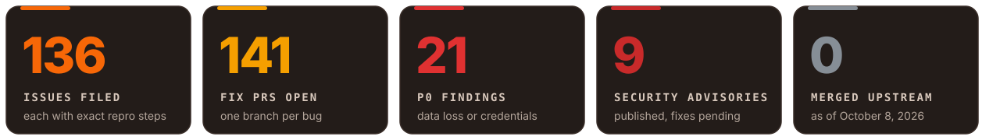
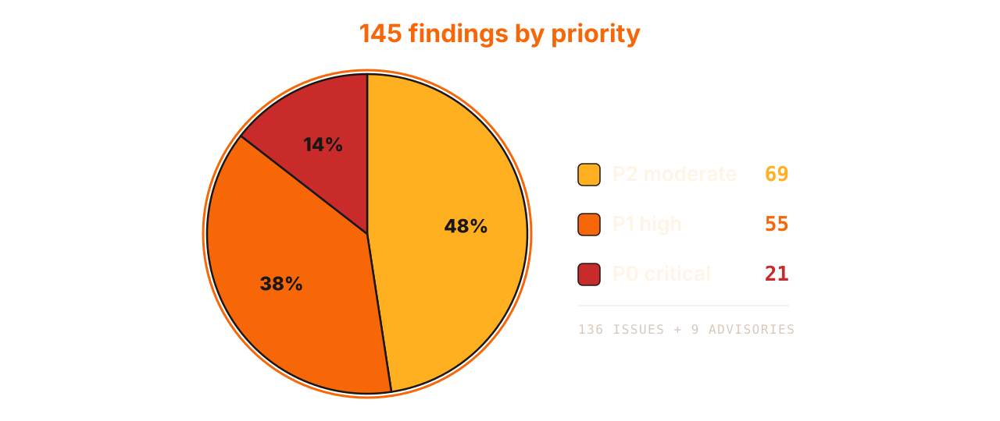
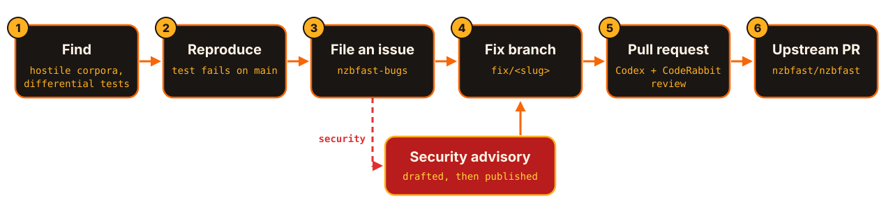

<div align="center">

<picture>
  <source media="(prefers-color-scheme: dark)" srcset="assets/banner-dark.svg">
  <source media="(prefers-color-scheme: light)" srcset="assets/banner-light.svg">
  
</picture>

<br>

[](#security-fix-these-first) [](#p0-critical-bugs) [](https://github.com/nzbfast/nzbfast/releases) [](https://github.com/nzbfast-bugs/nzbfast-bugs/issues) [](https://github.com/nzbfast-bugs/nzbfast-bugs/pulls) [](https://github.com/nzbfast/nzbfast) [](https://developers.google.com/style)

**[Overview](#overview)** · **[Security](#security-fix-these-first)** · **[P0](#p0-critical-bugs)** · **[P1](#p1-high-priority-bugs)** · **[P2](#p2-moderate-bugs)** · **[Workflow](#how-this-organization-works)** · **[Contributing](#contributing)**

</div>

> [!CAUTION]
> **nzbfast 1.7.1 isn't ready for production.** This organization has filed 145 findings against it, including 21 P0 bugs that silently corrupt or delete data, or expose credentials, while nzbfast reports success. None of the fixes have merged upstream yet. Don't expose nzbfast to the public internet, and keep independent backups of anything it writes.


## Overview


[nzbfast](https://github.com/nzbfast/nzbfast) is a Usenet downloader written in Rust. It ships as one self-contained executable that downloads, verifies, and extracts in a single pass. It speaks the SABnzbd and NZBGet APIs, so Sonarr, Radarr, nzb360, and LunaSea connect without changes. Its [project site](https://nzbfast.github.io/nzbfast/) bills it as "the fastest NZB downloader." The team introduced nzbfast and its PAR2 engine, parfast, to the [`r/usenet` community on September 12, 2026](https://www.reddit.com/r/usenet/comments/1wewk2u/announcing_parfast_a_high_performance_par2_tool/).

Speed claims aside, nzbfast is weeks old, and a young downloader touches everything you care about: your library, your provider accounts, and your disk. **nzbfast-bugs** exists to find its bugs early and get them fixed properly.

- **Find.** Contributors drive nzbfast with hostile and malformed corpora, differential decoder tests, and real client traffic.
- **Reproduce.** Every finding becomes an issue with exact steps, expected and actual results, and impact, usually backed by a test that fails on `main`.
- **Fix.** Every fix lives on its own `fix/<slug>` branch in a fork of the upstream repository, with a regression test.
- **Review.** Codex and CodeRabbit review each pull request before it goes upstream.
- **Upstream.** Reviewed fixes go to [`nzbfast/nzbfast`](https://github.com/nzbfast/nzbfast) as focused, test-backed pull requests.

| Resource | Link |
|---|---|
| Upstream repository | [nzbfast/nzbfast](https://github.com/nzbfast/nzbfast) |
| Project site | [nzbfast.github.io/nzbfast](https://nzbfast.github.io/nzbfast/) |
| Launch announcement | [`r/usenet`, September 12, 2026](https://www.reddit.com/r/usenet/comments/1wewk2u/announcing_parfast_a_high_performance_par2_tool/) |
| Bug tracker and fixes | [nzbfast-bugs/nzbfast-bugs](https://github.com/nzbfast-bugs/nzbfast-bugs) |

## At a glance

<picture>
  <source media="(prefers-color-scheme: dark)" srcset="assets/stats-dark.svg">
  <source media="(prefers-color-scheme: light)" srcset="assets/stats-light.svg">
  
</picture>

<picture>
  <source media="(prefers-color-scheme: dark)" srcset="assets/priority-dark.svg">
  <source media="(prefers-color-scheme: light)" srcset="assets/priority-light.svg">
  
</picture>

<sub>Snapshot of [nzbfast-bugs/nzbfast-bugs](https://github.com/nzbfast-bugs/nzbfast-bugs) on October 8, 2026, against nzbfast 1.7.1 (`main` at `370da77`): 136 issues, 9 published [security advisories](https://github.com/nzbfast-bugs/nzbfast-bugs/security/advisories), 141 open fix pull requests, and 449 review comments. The badges at the top of this page update live.</sub>

## Priority and severity scale

Priority says how urgently a bug needs a fix. Severity says how bad the outcome is when it happens.

| Priority | What it means | Expected response |
|---|---|---|
|  | Silent data loss or corruption reported as success, destructive file deletion, credential exposure, or compromise through untrusted input | Fix before anyone relies on nzbfast |
|  | Wrong results that cost money, bandwidth, availability, or automation correctness, or a security weakness that needs preconditions | Fix before a stable release |
|  | Compatibility gaps, misleading diagnostics, parsing edge cases, and cosmetic problems | Fix as time allows |

| Severity | Outcome |
|---|---|
| 🔴 Critical | Irreversible loss of data or credentials, or full control of the instance |
| 🟠 High | Data damage you can recover from, money lost, or an outage |
| 🟡 Medium | Wrong behavior with a workaround, or a limited security weakness |
| 🟢 Low | Inconvenience, cosmetic problems, or rare edge cases |


## Security: fix these first

> [!WARNING]
> Every finding in this section is reachable by someone other than the owner: a Usenet poster, an indexer or feed operator, anyone who holds an add-only API key, or anyone who can open a TCP connection to the port. Treat every NZB as untrusted input, and treat an internet-facing nzbfast as compromised until these fixes ship.

### Worst case on the public internet

The individual findings below are serious. Together, on an instance reachable from the internet, they chain into a full takeover:

1. **Delivery.** An attacker posts a release whose media filename carries a script fragment. An *arr app or an RSS rule grabs it for you ([`GHSA-34mp-c494-gpx2`](https://github.com/nzbfast-bugs/nzbfast-bugs/security/advisories/GHSA-34mp-c494-gpx2)).
2. **Execution.** With the preview mode set to `full`, you open the job and press play. The script runs in your dashboard with your API key.
3. **Credential theft.** The script repoints your Usenet server entry at a host the attacker controls. A blank password field means "keep the stored password," so nzbfast signs in to the attacker's host with your provider username and password ([`GHSA-957v-98xg-w723`](https://github.com/nzbfast-bugs/nzbfast-bugs/security/advisories/GHSA-957v-98xg-w723)).
4. **Persistence.** You notice and change the dashboard password. A login the attacker started before the change still receives a 14-day session that can read the API key ([`GHSA-w2qf-h7f3-fh3r`](https://github.com/nzbfast-bugs/nzbfast-bugs/security/advisories/GHSA-w2qf-h7f3-fh3r)).
5. **Denial of service.** Separately, anyone can hold all 8 HTTP workers open with slow connections and take the dashboard, the API, and the health check offline, with no credentials at all ([#4](https://github.com/nzbfast-bugs/nzbfast-bugs/issues/4)).

Each step is an existing finding with a fix waiting for review. Until those fixes merge, nothing stands between an exposed instance and this outcome.

### Who can trigger what

| Attacker | What they control | Findings they can trigger |
|---|---|---|
| Anyone who can reach the port, with no credentials | TCP connections and request timing | [#4](https://github.com/nzbfast-bugs/nzbfast-bugs/issues/4), [#140](https://github.com/nzbfast-bugs/nzbfast-bugs/issues/140) |
| Any Usenet poster | File names, yEnc headers, PAR2 packets, archive contents | [`GHSA-34mp-c494-gpx2`](https://github.com/nzbfast-bugs/nzbfast-bugs/security/advisories/GHSA-34mp-c494-gpx2), [`GHSA-frwg-6w7r-55fj`](https://github.com/nzbfast-bugs/nzbfast-bugs/security/advisories/GHSA-frwg-6w7r-55fj), [`GHSA-wg64-2f7g-2cw5`](https://github.com/nzbfast-bugs/nzbfast-bugs/security/advisories/GHSA-wg64-2f7g-2cw5), and most P0 data bugs |
| An indexer or feed operator, or anyone on a plain-HTTP path | Feed bodies, release names, linked URLs | [#28](https://github.com/nzbfast-bugs/nzbfast-bugs/issues/28), [`GHSA-69r7-jc86-w692`](https://github.com/nzbfast-bugs/nzbfast-bugs/security/advisories/GHSA-69r7-jc86-w692), [`GHSA-9c36-37j9-mfhq`](https://github.com/nzbfast-bugs/nzbfast-bugs/security/advisories/GHSA-9c36-37j9-mfhq), [`GHSA-3qm6-8283-fv9v`](https://github.com/nzbfast-bugs/nzbfast-bugs/security/advisories/GHSA-3qm6-8283-fv9v) |
| Anyone with an add-only or full API key, including every *arr app you connect | `addurl`, `nzbname`, uploads | [#70](https://github.com/nzbfast-bugs/nzbfast-bugs/issues/70), [`GHSA-j2j5-8p7m-h3pp`](https://github.com/nzbfast-bugs/nzbfast-bugs/security/advisories/GHSA-j2j5-8p7m-h3pp), [`GHSA-69r7-jc86-w692`](https://github.com/nzbfast-bugs/nzbfast-bugs/security/advisories/GHSA-69r7-jc86-w692), [`GHSA-9c36-37j9-mfhq`](https://github.com/nzbfast-bugs/nzbfast-bugs/security/advisories/GHSA-9c36-37j9-mfhq) |
| Anyone who learns your dashboard password | The login form | [`GHSA-w2qf-h7f3-fh3r`](https://github.com/nzbfast-bugs/nzbfast-bugs/security/advisories/GHSA-w2qf-h7f3-fh3r), then everything an API key allows |

### Security findings in detail

Ranked by realistic risk to an internet-facing instance, highest first. Each advisory ID links to its published GitHub security advisory, and each finding names its fix. The priority and severity here rate the worst case for an internet-facing instance, so they can run higher than the advisory's own rating, which is listed in each entry.

<details>
<summary><b>1. Stored XSS in the dashboard player button</b> · <a href="https://github.com/nzbfast-bugs/nzbfast-bugs/security/advisories/GHSA-34mp-c494-gpx2"><code>GHSA-34mp-c494-gpx2</code></a> · P0 · 🔴 Critical</summary>

- **Advisory severity:** rated medium in [GHSA-34mp-c494-gpx2](https://github.com/nzbfast-bugs/nzbfast-bugs/security/advisories/GHSA-34mp-c494-gpx2).
- **Who can trigger it:** any Usenet poster. You must have the preview mode set to `full` (the default, `metadata-only`, isn't affected) and press the in-browser play button.
- **What happens:** the dashboard's `pvBlock()` player button passes the media filename to an inline `onclick` handler with HTML-attribute escaping only. The browser decodes those entities before it compiles the handler, so a single quote in the filename ends the JavaScript string and the rest of the name runs as code in the dashboard origin.
- **Worst case if exposed:** the script holds your API key and can call every `/api` mode. It can read your settings and the key itself, add or delete jobs, and rewrite server and indexer settings, which, combined with finding 2, sends your Usenet credentials to the attacker. Delivery needs nothing more than a post that your automation grabs.
- **Until it's fixed:** keep the preview mode at `metadata-only` and don't use the in-browser player.
- **Fix:** [#64](https://github.com/nzbfast-bugs/nzbfast-bugs/pull/64) encodes all 38 inline-handler arguments as JavaScript strings first, then as attributes, and adds a guard test that fails on the old pattern.

</details>

<details>
<summary><b>2. Editing a server's host sends the old password to the new host</b> · <a href="https://github.com/nzbfast-bugs/nzbfast-bugs/security/advisories/GHSA-957v-98xg-w723"><code>GHSA-957v-98xg-w723</code></a> · P0 · 🔴 Critical</summary>

- **Advisory severity:** rated medium in [GHSA-957v-98xg-w723](https://github.com/nzbfast-bugs/nzbfast-bugs/security/advisories/GHSA-957v-98xg-w723).
- **Who can trigger it:** anyone who can edit server settings: you, a hijacked session, or the script from finding 1.
- **What happens:** in `mode=server_save`, a blank password means "keep the stored password," even when the host or username changed. The dashboard never shows stored passwords, so the field is blank unless you retype it. SOCKS proxy passwords behave the same way.
- **Worst case if exposed:** repointing an entry at a new provider, a mistyped host, or an attacker's host sends your provider username and password, or your proxy password, to that host on the next connection. You pay for Usenet accounts, and many people reuse them across tools.
- **Until it's fixed:** to change a server or proxy host, delete the entry and create a new one, and retype the password.
- **Fix:** [#162](https://github.com/nzbfast-bugs/nzbfast-bugs/pull/162) keeps a stored password only when the host and username are unchanged.

</details>

<details>
<summary><b>3. An unauthenticated slow-connection flood takes the HTTP server down</b> · <a href="https://github.com/nzbfast-bugs/nzbfast-bugs/issues/4">#4</a> · P1 · 🟠 High</summary>

- **Who can trigger it:** anyone who can open a TCP connection to the port. It needs no API key or login.
- **What happens:** 8 blocking worker threads serve every HTTP route from one `tiny_http` server, and accepted connections have no read or idle timeout. A request that never finishes its body holds a worker forever, and authentication runs only after the body arrives.
- **Worst case if exposed:** a single client takes the dashboard, the whole API, and `mode=version`, which the Docker `HEALTHCHECK` uses, offline. The outage lasts until the connections drop or the container restarts. Sonarr and Radarr lose their download client, and orchestrators that restart unhealthy containers loop while the attack continues.
- **Until it's fixed:** keep the port private, or put a reverse proxy with request-body timeouts in front of it.
- **Fix:** [#24](https://github.com/nzbfast-bugs/nzbfast-bugs/pull/24) gives each peer IP a share of the connection ceiling.

</details>

<details>
<summary><b>4. The SSRF guard misses IPv4 addresses embedded in IPv6</b> · <a href="https://github.com/nzbfast-bugs/nzbfast-bugs/security/advisories/GHSA-j2j5-8p7m-h3pp"><code>GHSA-j2j5-8p7m-h3pp</code></a> · P1 · 🟠 High</summary>

- **Advisory severity:** rated medium in [GHSA-j2j5-8p7m-h3pp](https://github.com/nzbfast-bugs/nzbfast-bugs/security/advisories/GHSA-j2j5-8p7m-h3pp).
- **Who can trigger it:** anyone with an API key, including the add-only key you give to *arr apps, and any indexer whose links you add.
- **What happens:** the URL-fetch guard behind `addurl`, `/watch`, and poster fetching blocks the cloud metadata address `169.254.169.254`. It doesn't block the same address written in IPv6 forms: NAT64 (`64:ff9b::/96`), local-use NAT64, 6to4, IPv4-mapped, and IPv4-compatible.
- **Worst case if exposed:** on an IPv6-only cloud host behind NAT64 and DNS64, a URL whose hostname resolves to the NAT64 form of the metadata address reaches the instance metadata service. Instance credentials often unlock the wider cloud account.
- **Until it's fixed:** block the metadata service at the network layer (on AWS, require IMDSv2 with a hop limit of 1), and avoid IPv6-only NAT64 subnets.
- **Fix:** [#174](https://github.com/nzbfast-bugs/nzbfast-bugs/pull/174) checks the embedded IPv4 address in all five forms against the IPv4 rules.

</details>

<details>
<summary><b>5. A login in flight during a password change keeps a 14-day session</b> · <a href="https://github.com/nzbfast-bugs/nzbfast-bugs/security/advisories/GHSA-w2qf-h7f3-fh3r"><code>GHSA-w2qf-h7f3-fh3r</code></a> · P1 · 🟠 High</summary>

- **Advisory severity:** rated medium in [GHSA-w2qf-h7f3-fh3r](https://github.com/nzbfast-bugs/nzbfast-bugs/security/advisories/GHSA-w2qf-h7f3-fh3r).
- **Who can trigger it:** anyone who knows the old dashboard password.
- **What happens:** changing the password or username, or signing out everywhere, revokes only the sessions that exist at that moment. A login that checked the old password before the change and finishes after it receives a fresh 14-day session.
- **Worst case if exposed:** your password leaks, and you change it, which is the standard response. An attacker who keeps signing in with the old password wins the race and keeps a full-control session that can read the API key for two weeks.
- **Until it's fixed:** block access to the login page, for example at your reverse proxy, while you change the password, then rotate the API key.
- **Fix:** [#68](https://github.com/nzbfast-bugs/nzbfast-bugs/pull/68) ties each new session to the credential epoch it was checked against.

</details>

<details>
<summary><b>6. A hostile yEnc size writes a file of about 1 TiB</b> · <a href="https://github.com/nzbfast-bugs/nzbfast-bugs/security/advisories/GHSA-frwg-6w7r-55fj"><code>GHSA-frwg-6w7r-55fj</code></a> · P1 · 🟠 High</summary>

- **Advisory severity:** rated medium in [GHSA-frwg-6w7r-55fj](https://github.com/nzbfast-bugs/nzbfast-bugs/security/advisories/GHSA-frwg-6w7r-55fj).
- **Who can trigger it:** any Usenet poster.
- **What happens:** an article can declare a huge `size=` with a matching `begin` and `end` range and a valid CRC. nzbfast writes it at that offset, even though the NZB says the file is far smaller.
- **Worst case if exposed:** the output file grows to about 1 TiB. On filesystems without sparse files, which includes many NAS shares and exFAT drives, that fills the disk and stalls every download and anything else that shares the volume. PAR2 and unpack then work on a file of the wrong size.
- **Until it's fixed:** give the download folder its own volume or filesystem quota.
- **Fix:** [#142](https://github.com/nzbfast-bugs/nzbfast-bugs/pull/142) caps placement at the NZB's posted size.

</details>

<details>
<summary><b>7. A bare CR in a job name enables SMTP smuggling</b> · <a href="https://github.com/nzbfast-bugs/nzbfast-bugs/security/advisories/GHSA-69r7-jc86-w692"><code>GHSA-69r7-jc86-w692</code></a> · P1 · 🟡 Medium</summary>

- **Advisory severity:** rated medium in [GHSA-69r7-jc86-w692](https://github.com/nzbfast-bugs/nzbfast-bugs/security/advisories/GHSA-69r7-jc86-w692).
- **Who can trigger it:** anyone who can set a job name, such as API key holders and *arr apps that pass along an indexer's release name.
- **What happens:** the job name goes into the email notification body, and a lone carriage return reaches the wire unchanged. A name can therefore produce the byte sequence that some mail servers accept as the end of the message.
- **Worst case if exposed:** on a mail server that's vulnerable to SMTP smuggling, the rest of the name runs as SMTP commands. The attacker can send mail that appears to come from your notification account, which lends your domain's reputation to phishing or spam.
- **Until it's fixed:** turn off email notifications, or switch to Apprise or Gotify.
- **Fix:** [#151](https://github.com/nzbfast-bugs/nzbfast-bugs/pull/151) normalizes every line ending before dot-stuffing.

</details>

<details>
<summary><b>8. The RSS parser goes quadratic on runs of <code>&lt;</code></b> · <a href="https://github.com/nzbfast-bugs/nzbfast-bugs/issues/28">#28</a> · P1 · 🟡 Medium</summary>

- **Who can trigger it:** the operator of any RSS or newznab feed you configure, or anyone on the network path of a plain-HTTP feed.
- **What happens:** for every `<` in the feed, the element-name scan can run to the end of the buffer, and every field lookup repeats it. 32 KB of `<` characters takes about 40 seconds, and 1 MB would take hours.
- **Worst case if exposed:** a tiny response pins a CPU core on every poll, indefinitely. On low-power NAS hardware this starves downloads and every other service on the box.
- **Until it's fixed:** use HTTPS feeds from indexers you trust.
- **Fix:** [#30](https://github.com/nzbfast-bugs/nzbfast-bugs/pull/30) keeps the element scan linear in the input.

</details>

<details>
<summary><b>9. <code>addurl</code> fetches block the API workers</b> · <a href="https://github.com/nzbfast-bugs/nzbfast-bugs/issues/70">#70</a> · P1 · 🟡 Medium</summary>

- **Who can trigger it:** anyone with the add-only key, which every *arr app and phone client holds, or anyone who gets you to add a URL on a slow host.
- **What happens:** `mode=addurl` fetches the URL inside the HTTP worker. Eight slow URLs occupy all 8 workers for up to 60 seconds each.
- **Worst case if exposed:** a low-privilege key freezes the entire API and the health check, as often as the sender likes, without the full API key.
- **Until it's fixed:** guard the add-only key as carefully as the full key.
- **Fix:** [#73](https://github.com/nzbfast-bugs/nzbfast-bugs/pull/73) caps fetches that hold a worker and answers "busy" past the cap.

</details>

<details>
<summary><b>10. A NUL byte in a job name stops every post-processing script</b> · <a href="https://github.com/nzbfast-bugs/nzbfast-bugs/security/advisories/GHSA-9c36-37j9-mfhq"><code>GHSA-9c36-37j9-mfhq</code></a> · P1 · 🟡 Medium</summary>

- **Advisory severity:** rated low in [GHSA-9c36-37j9-mfhq](https://github.com/nzbfast-bugs/nzbfast-bugs/security/advisories/GHSA-9c36-37j9-mfhq).
- **Who can trigger it:** anyone who can add jobs, including through an *arr app that relays an indexer's release name.
- **What happens:** nzbfast stores `nzbname` and upload filenames without removing control characters. A NUL byte reaches the script's arguments and environment, and the operating system refuses to start the process.
- **Worst case if exposed:** importer and notifier scripts silently never run for that job, and history marks it as a script failure.
- **Fix:** [#157](https://github.com/nzbfast-bugs/nzbfast-bugs/pull/157) strips control characters from API-supplied names.

</details>

<details>
<summary><b>11. The archive password stays in the job name and folder</b> · <a href="https://github.com/nzbfast-bugs/nzbfast-bugs/security/advisories/GHSA-wg64-2f7g-2cw5"><code>GHSA-wg64-2f7g-2cw5</code></a> · P1 · 🟡 Medium</summary>

- **Advisory severity:** rated low in [GHSA-wg64-2f7g-2cw5](https://github.com/nzbfast-bugs/nzbfast-bugs/security/advisories/GHSA-wg64-2f7g-2cw5).
- **Who can trigger it:** any release name that has a second brace group next to the `{password}` group.
- **What happens:** the parser promises to remove the password from the name, but when another brace group is present it removes nothing.
- **Worst case if exposed:** the password shows in the queue, in history, including the add-only `status` view, in the folder name on a shared drive, and in logs and notifications. The archive also fails to extract.
- **Fix:** [#169](https://github.com/nzbfast-bugs/nzbfast-bugs/pull/169) takes the last non-tag brace group as the password.

</details>

<details>
<summary><b>12. A newline in a job name forges log lines</b> · <a href="https://github.com/nzbfast-bugs/nzbfast-bugs/security/advisories/GHSA-3qm6-8283-fv9v"><code>GHSA-3qm6-8283-fv9v</code></a> · P1 · 🟢 Low</summary>

- **Advisory severity:** rated low in [GHSA-3qm6-8283-fv9v](https://github.com/nzbfast-bugs/nzbfast-bugs/security/advisories/GHSA-3qm6-8283-fv9v).
- **Who can trigger it:** anyone who can set a job name.
- **What happens:** several log messages include the job name raw, and the log formatter doesn't escape line breaks.
- **Worst case if exposed:** one event writes extra, complete log lines with any timestamp, level, and source the attacker chooses. Forged entries appear in the dashboard log, `mode=log`, and container logs, and can bury real activity during an investigation.
- **Fix:** [#158](https://github.com/nzbfast-bugs/nzbfast-bugs/pull/158) escapes control characters so that one event is always one line.

</details>

<details>
<summary><b>13. <code>PUID=0</code> runs the daemon and its helpers as root</b> · <a href="https://github.com/nzbfast-bugs/nzbfast-bugs/issues/22">#22</a> · P1 · 🟡 Medium</summary>

- **Who can trigger it:** the operator, often by copying a common Docker guide that sets `PUID=0` to fix permissions.
- **What happens:** the entrypoint says the daemon never runs as root, but an explicit `PUID=0` skips that check. nzbfast, `unrar`, `par2`, and your scripts then run as root.
- **Worst case if exposed:** any future code-execution bug in the unpack chain lands as root. With a plain `docker run` that lacks the compose file's `cap_drop` and `no-new-privileges`, nothing else stands in the way.
- **Fix:** [#27](https://github.com/nzbfast-bugs/nzbfast-bugs/pull/27) warns loudly when the daemon would run as root.

</details>

<details>
<summary><b>14. Malformed <code>%</code> escapes decode to control bytes</b> · <a href="https://github.com/nzbfast-bugs/nzbfast-bugs/issues/140">#140</a> · P1 · 🟡 Medium</summary>

- **Who can trigger it:** any HTTP client.
- **What happens:** the URL decoder accepts `%` followed by a sign and one hex digit as an escape, so `%+A` becomes a newline.
- **Worst case if exposed:** filters that look for the canonical `%0A` miss these control characters, which then feed the log-forging, SMTP, and NUL-byte findings. It affects query strings, form bodies, and the JSON-RPC path password.
- **Fix:** [#143](https://github.com/nzbfast-bugs/nzbfast-bugs/pull/143) decodes an escape only when both characters are hex digits.

</details>

<details>
<summary><b>15. HTML error pages are cached as posters and served as images</b> · <a href="https://github.com/nzbfast-bugs/nzbfast-bugs/issues/253">#253</a> · P2 · 🟡 Medium</summary>

- **Who can trigger it:** any artwork or metadata host, or a captive portal between you and it.
- **What happens:** poster fetching accepts any `2xx` response without checking the media type or image signature. nzbfast caches the response for good and serves it from `/art/` as `image/jpeg` with a 7-day cache. No route sets `X-Content-Type-Options: nosniff`.
- **Worst case if exposed:** a hostile or compromised host places arbitrary bytes in your dashboard's origin, and only browser sniffing rules keep that content inert.
- **Fix:** [#254](https://github.com/nzbfast-bugs/nzbfast-bugs/pull/254) caches and serves only real images, with `nosniff`.

</details>

<details>
<summary><b>16. Documented reverse-proxy setups can't sign in</b> · <a href="https://github.com/nzbfast-bugs/nzbfast-bugs/issues/67">#67</a> · P2 · 🟡 Medium</summary>

- **Who can trigger it:** anyone who follows the manual's Apache configuration, or runs nginx on a non-default public port.
- **What happens:** every login gets `403 login.crosssite`, because the same-site check ignores the forwarded host.
- **Worst case if exposed:** the check itself fails closed, but locked-out owners tend to turn off the login or publish the port directly to get back in, which exposes everything in the preceding list.
- **Fix:** [#69](https://github.com/nzbfast-bugs/nzbfast-bugs/pull/69) accepts the proxy's forwarded host and corrects the nginx recipe.

</details>

Related hardening findings: the image ships 8 setuid binaries despite a comment that says otherwise ([#19](https://github.com/nzbfast-bugs/nzbfast-bugs/issues/19)), TMDB lookups ignore the outbound-call switch ([#255](https://github.com/nzbfast-bugs/nzbfast-bugs/issues/255)), and XML output carries raw control characters ([#16](https://github.com/nzbfast-bugs/nzbfast-bugs/issues/16)).

### Run nzbfast more safely today

If you run nzbfast 1.7.1 anyway, these steps blunt the worst outcomes described here:

- [ ] Keep nzbfast off the public internet. Reach it through a VPN such as WireGuard or Tailscale.
- [ ] Set `web_username` and `web_password`, and keep the preview mode at `metadata-only`.
- [ ] Never run a bulk history delete with `del_files=1`.
- [ ] Copy `config.json` somewhere safe after every server change.
- [ ] Prefer posts that carry PAR2 recovery data, and spot-check important files yourself.
- [ ] Don't rely on the download quota for metered or block accounts.
- [ ] Keep the compose file's `cap_drop` and `no-new-privileges` settings, and never set `PUID=0`.
- [ ] Turn off email notifications until [#151](https://github.com/nzbfast-bugs/nzbfast-bugs/pull/151) merges.


## P0: critical bugs

P0 bugs destroy or silently corrupt data, or expose credentials, usually while nzbfast reports success. They're ranked by severity, most severe first. A row that names two findings shares one root cause.

| Rank | Bug | What it breaks | If it isn't fixed | Fix |
|:---:|---|---|---|---|
| **1** | **Clearing history with delete-files erases completed downloads**<br><sub>[#198](https://github.com/nzbfast-bugs/nzbfast-bugs/issues/198) · 🔴 Critical</sub> | SABnzbd API bulk history delete with `del_files=1` | One routine "clear history and delete files" call from a SABnzbd client or script removes the folder of every completed job, so your downloaded library is gone for good. SABnzbd only deletes files of failed jobs here. | [#200](https://github.com/nzbfast-bugs/nzbfast-bugs/pull/200) |
| **2** | **Stored XSS in the dashboard player button**<br><sub>[`GHSA-34mp-c494-gpx2`](https://github.com/nzbfast-bugs/nzbfast-bugs/security/advisories/GHSA-34mp-c494-gpx2) · 🔴 Critical</sub> | Dashboard in-browser player, preview mode `full` | A crafted filename in any Usenet post runs script in your dashboard with your API key. The script can read settings, add or delete jobs, and rewrite server and indexer settings. See [Security](#security-fix-these-first). | [#64](https://github.com/nzbfast-bugs/nzbfast-bugs/pull/64) |
| **3** | **Editing a server's host sends the old password to the new host**<br><sub>[`GHSA-957v-98xg-w723`](https://github.com/nzbfast-bugs/nzbfast-bugs/security/advisories/GHSA-957v-98xg-w723) · 🔴 Critical</sub> | Server and SOCKS proxy settings in `mode=server_save` | Repointing a server or proxy without retyping the password hands your provider username and password to whatever host you typed. See [Security](#security-fix-these-first). | [#162](https://github.com/nzbfast-bugs/nzbfast-bugs/pull/162) |
| **4** | **Deleting one job can delete a whole category folder**<br><sub>[#195](https://github.com/nzbfast-bugs/nzbfast-bugs/issues/195) · [#197](https://github.com/nzbfast-bugs/nzbfast-bugs/issues/197) · 🔴 Critical</sub> | History delete with `del_files=1`, job folder naming | An uncategorized job named like a category (`tv.nzb`) takes the folder `out/tv`. Later `tv` jobs land inside it, and deleting the first job removes all of them, including queued ones. | [#196](https://github.com/nzbfast-bugs/nzbfast-bugs/pull/196)<br>[#199](https://github.com/nzbfast-bugs/nzbfast-bugs/pull/199) |
| **5** | **A truncated `config.json` wipes every provider on the next save**<br><sub>[#108](https://github.com/nzbfast-bugs/nzbfast-bugs/issues/108) · 🔴 Critical</sub> | Config persistence and recovery | One torn write or crash makes nzbfast report "no servers." The suggested fix, adding a server, overwrites the file and permanently loses every provider and credential. No usable backup exists. | [#109](https://github.com/nzbfast-bugs/nzbfast-bugs/pull/109) |
| **6** | **A RAR set missing its last volume reports success and deletes its volumes**<br><sub>[#49](https://github.com/nzbfast-bugs/nzbfast-bugs/issues/49) · 🔴 Critical</sub> | Disk unpack pass | Members go silently missing, and nzbfast deletes the volumes you need for PAR2 repair or for re-downloading the missing part. | [#53](https://github.com/nzbfast-bugs/nzbfast-bugs/pull/53) |
| **7** | **A split, stored 7z set extracts corrupted while the job says Completed**<br><sub>[#1](https://github.com/nzbfast-bugs/nzbfast-bugs/issues/1) · 🔴 Critical</sub> | One-pass 7z direct-map extraction | The first article of each continuation volume is wrong in the output. PAR2 can't catch it, because the damage is in the extracted file, not in the downloaded volumes. | [#2](https://github.com/nzbfast-bugs/nzbfast-bugs/pull/2) (closed) |
| **8** | **A conflicting duplicate article corrupts a direct-unpacked file and passes every check**<br><sub>[#192](https://github.com/nzbfast-bugs/nzbfast-bugs/issues/192) · 🔴 Critical</sub> | Direct unpack (RAR5 store) | When the good copy arrives first, the bad copy overwrites it on disk and the CRC still reports success. Without PAR2, the job completes with a corrupt file. | [#194](https://github.com/nzbfast-bugs/nzbfast-bugs/pull/194) |
| **9** | **A yEnc part without `=ypart` overwrites the head of the file**<br><sub>[#45](https://github.com/nzbfast-bugs/nzbfast-bugs/issues/45) · 🔴 Critical</sub> | yEnc decoder (scalar and SIMD) | nzbfast writes every non-first part from a broken poster at offset 0, so the last one to arrive overwrites the start of the file. Without PAR2, nothing reports an error. | [#51](https://github.com/nzbfast-bugs/nzbfast-bugs/pull/51) |
| **10** | **Archives in a pre-existing subfolder are permanently deleted**<br><sub>[#185](https://github.com/nzbfast-bugs/nzbfast-bugs/issues/185) · 🟠 High</sub> | Nested unpack and `extract` with CD1 and CD2 layouts | nzbfast removes your own input archives after extraction. The deletion bypasses Trash, so you can't recover them. | [#186](https://github.com/nzbfast-bugs/nzbfast-bugs/pull/186) |
| **11** | **A watchlist upgrade deletes the only copy of two episodes**<br><sub>[#237](https://github.com/nzbfast-bugs/nzbfast-bugs/issues/237) · 🟠 High</sub> | Watchlist with `upgrade=true` and `delete_old=true` | A single-episode `S01E01` upgrade replaces an `S01E01E02E03` download and deletes it. E02 and E03 are gone. | [#238](https://github.com/nzbfast-bugs/nzbfast-bugs/pull/238) |
| **12** | **An archive with a file and a same-named folder drops entries or loses the download**<br><sub>[#10](https://github.com/nzbfast-bugs/nzbfast-bugs/issues/10) · 🟠 High</sub> | zip, RAR, and tar extraction | zip jobs report Completed with entries silently gone and the archive consumed. RAR jobs lose the whole download, so you must download it again. | [#37](https://github.com/nzbfast-bugs/nzbfast-bugs/pull/37) |
| **13** | **A plain file keeps an over-stated size and ships a zero-filled tail**<br><sub>[#21](https://github.com/nzbfast-bugs/nzbfast-bugs/issues/21) · 🟠 High</sub> | In-stream writer for non-archive files | The job reports OK, but the file on disk differs from the post. Without PAR2, media players and checksum tools are the first to notice. | [#31](https://github.com/nzbfast-bugs/nzbfast-bugs/pull/31) |
| **14** | **Backup import accepts a config the daemon can't load and keeps no backup**<br><sub>[#111](https://github.com/nzbfast-bugs/nzbfast-bugs/issues/111) · 🟠 High</sub> | `mode=backup_import` | After the restart it asks for, the daemon can't load its config and your previous servers are gone. | [#113](https://github.com/nzbfast-bugs/nzbfast-bugs/pull/113) |
| **15** | **Backup import is silently undone by a concurrent server save**<br><sub>[#110](https://github.com/nzbfast-bugs/nzbfast-bugs/issues/110) · 🟠 High</sub> | `mode=backup_import`, config write locks | A concurrent save reverts a restore that reported success, with no error, and you find out only when your servers are missing. | [#112](https://github.com/nzbfast-bugs/nzbfast-bugs/pull/112) |
| **16** | **One rebuilt file excuses two missing files**<br><sub>[#146](https://github.com/nzbfast-bugs/nzbfast-bugs/issues/146) · 🟠 High</sub> | Settle (PAR2 reconciliation of obfuscated files) | The job reports success while a file is still missing. | [#148](https://github.com/nzbfast-bugs/nzbfast-bugs/pull/148) |
| **17** | **The SIMD yEnc decoder fabricates a data byte**<br><sub>[#118](https://github.com/nzbfast-bugs/nzbfast-bugs/issues/118) · 🟠 High</sub> | SIMD yEnc decoder, the hot path | Articles without a CRC gain a fake `0xa3` byte and the rest of the part shifts by one byte. It also refuses articles that the reference decoder accepts. | [#120](https://github.com/nzbfast-bugs/nzbfast-bugs/pull/120) |
| **18** | **A zip with false yEnc `size=` claims is truncated or zero-padded**<br><sub>[#20](https://github.com/nzbfast-bugs/nzbfast-bugs/issues/20) · 🟠 High</sub> | In-stream zip extraction | nzbfast discards downloaded bytes, reports the archive as malformed, and never extracts its members. | [#32](https://github.com/nzbfast-bugs/nzbfast-bugs/pull/32) |
| **19** | **The hourly spool sweep deletes queued jobs' NZB files**<br><sub>[#211](https://github.com/nzbfast-bugs/nzbfast-bugs/issues/211) · 🟠 High</sub> | Maintenance sweep while the queue store is unreadable | After you fix the file permissions and restart, your queue rows come back with no NZB to download from. | [#213](https://github.com/nzbfast-bugs/nzbfast-bugs/pull/213) |
| **20** | **The history count limit drops pending retries and orphans partial folders**<br><sub>[#90](https://github.com/nzbfast-bugs/nzbfast-bugs/issues/90) · 🟠 High</sub> | `history_keep_count`, automatic retry | The retry never runs, nzbfast deletes the NZB so a manual retry is impossible, and partial folders pile up until the disk fills. | [#91](https://github.com/nzbfast-bugs/nzbfast-bugs/pull/91) |

## P1: high-priority bugs

P1 bugs cost money, bandwidth, or availability, break automation, or weaken security under specific conditions. Rows in each group run from most to least severe.

### Security and availability

| Bug | What it breaks | If it isn't fixed | Fix |
|---|---|---|---|
| **An unauthenticated slow-connection flood takes the HTTP server down**<br><sub>[#4](https://github.com/nzbfast-bugs/nzbfast-bugs/issues/4) · 🟠 High</sub> | HTTP listener: 8 workers, no read timeout | Anyone who can reach the port stops the dashboard, the API, and the Docker health check, with no credentials. | [#24](https://github.com/nzbfast-bugs/nzbfast-bugs/pull/24) |
| **The SSRF guard misses IPv4 addresses embedded in IPv6**<br><sub>[`GHSA-j2j5-8p7m-h3pp`](https://github.com/nzbfast-bugs/nzbfast-bugs/security/advisories/GHSA-j2j5-8p7m-h3pp) · 🟠 High</sub> | `addurl`, `/watch`, poster fetching | On IPv6-only clouds behind NAT64, a URL can reach the instance metadata service and its credentials. | [#174](https://github.com/nzbfast-bugs/nzbfast-bugs/pull/174) |
| **A login in flight during a password change keeps a 14-day session**<br><sub>[`GHSA-w2qf-h7f3-fh3r`](https://github.com/nzbfast-bugs/nzbfast-bugs/security/advisories/GHSA-w2qf-h7f3-fh3r) · 🟠 High</sub> | Dashboard login | Changing a leaked password doesn't lock the attacker out. | [#68](https://github.com/nzbfast-bugs/nzbfast-bugs/pull/68) |
| **A hostile yEnc `size=` writes a file of about 1 TiB**<br><sub>[`GHSA-frwg-6w7r-55fj`](https://github.com/nzbfast-bugs/nzbfast-bugs/security/advisories/GHSA-frwg-6w7r-55fj) · 🟠 High</sub> | Article placement | Any poster can fill your disk on filesystems without sparse files. | [#142](https://github.com/nzbfast-bugs/nzbfast-bugs/pull/142) |
| **A bare CR in a job name enables SMTP smuggling**<br><sub>[`GHSA-69r7-jc86-w692`](https://github.com/nzbfast-bugs/nzbfast-bugs/security/advisories/GHSA-69r7-jc86-w692) · 🟡 Medium</sub> | Notifications by email | A job name can inject SMTP commands on mail servers vulnerable to smuggling. | [#151](https://github.com/nzbfast-bugs/nzbfast-bugs/pull/151) |
| **The RSS parser goes quadratic on runs of `<`**<br><sub>[#28](https://github.com/nzbfast-bugs/nzbfast-bugs/issues/28) · 🟡 Medium</sub> | RSS and newznab feed parsing | One crafted feed response pins a CPU core for hours. | [#30](https://github.com/nzbfast-bugs/nzbfast-bugs/pull/30) |
| **`addurl` fetches block the API workers**<br><sub>[#70](https://github.com/nzbfast-bugs/nzbfast-bugs/issues/70) · 🟡 Medium</sub> | `mode=addurl` | A few slow URLs hang `/api` and the health check for up to 60 seconds each, as often as the sender repeats them. | [#73](https://github.com/nzbfast-bugs/nzbfast-bugs/pull/73) |
| **A NUL byte in a job name stops every post-processing script**<br><sub>[`GHSA-9c36-37j9-mfhq`](https://github.com/nzbfast-bugs/nzbfast-bugs/security/advisories/GHSA-9c36-37j9-mfhq) · 🟡 Medium</sub> | `nzbname`, upload filenames, scripts | An add-only key or a relayed indexer name silently disables your importer and notifier scripts for that job. | [#157](https://github.com/nzbfast-bugs/nzbfast-bugs/pull/157) |
| **The archive password stays in the job name and folder**<br><sub>[`GHSA-wg64-2f7g-2cw5`](https://github.com/nzbfast-bugs/nzbfast-bugs/security/advisories/GHSA-wg64-2f7g-2cw5) · 🟡 Medium</sub> | Release-name password parsing | The password shows in the queue, history, folder names, logs, and notifications, and the archive isn't extracted. | [#169](https://github.com/nzbfast-bugs/nzbfast-bugs/pull/169) |
| **A newline in a job name forges log lines**<br><sub>[`GHSA-3qm6-8283-fv9v`](https://github.com/nzbfast-bugs/nzbfast-bugs/security/advisories/GHSA-3qm6-8283-fv9v) · 🟢 Low</sub> | Logging | Fake entries are indistinguishable from real ones, which misleads incident response. | [#158](https://github.com/nzbfast-bugs/nzbfast-bugs/pull/158) |
| **`PUID=0` runs the daemon, `unrar`, `par2`, and scripts as root**<br><sub>[#22](https://github.com/nzbfast-bugs/nzbfast-bugs/issues/22) · 🟡 Medium</sub> | Docker entrypoint | One commonly copied setting breaks the documented "never root" promise. | [#27](https://github.com/nzbfast-bugs/nzbfast-bugs/pull/27) |
| **Malformed `%` escapes decode to control bytes**<br><sub>[#140](https://github.com/nzbfast-bugs/nzbfast-bugs/issues/140) · 🟡 Medium</sub> | Query and form parsing | Control characters slip past filters that look for `%0A`, which feeds the injection preceding findings. | [#143](https://github.com/nzbfast-bugs/nzbfast-bugs/pull/143) |

### Money and provider limits

| Bug | What it breaks | If it isn't fixed | Fix |
|---|---|---|---|
| **The quota is checked only between jobs**<br><sub>[#50](https://github.com/nzbfast-bugs/nzbfast-bugs/issues/50) · 🟠 High</sub> | Download quota | With 1 byte of quota left, a 50 GB job still downloads in full, which means real overage charges on metered accounts. | [#57](https://github.com/nzbfast-bugs/nzbfast-bugs/pull/57) |
| **A running job's bytes don't count, so the next job starts anyway**<br><sub>[#221](https://github.com/nzbfast-bugs/nzbfast-bugs/issues/221) · 🟠 High</sub> | Quota hand-over check | Downloads blow past the cap while the dashboard shows quota left. | [#232](https://github.com/nzbfast-bugs/nzbfast-bugs/pull/232) |
| **Bytes downloaded before a crash never count against the quota**<br><sub>[#222](https://github.com/nzbfast-bugs/nzbfast-bugs/issues/222) · 🟠 High</sub> | Quota ledger persistence | Each crash or restart during a job forgives its traffic. | [#231](https://github.com/nzbfast-bugs/nzbfast-bugs/pull/231) |
| **A `block_account` server buys duplicate articles**<br><sub>[#82](https://github.com/nzbfast-bugs/nzbfast-bugs/issues/82) · 🟠 High</sub> | Server routing | You spend paid block bytes on articles that a flat-rate server is already delivering. | [#83](https://github.com/nzbfast-bugs/nzbfast-bugs/pull/83) |
| **Switching the quota period resets the month's spend**<br><sub>[#219](https://github.com/nzbfast-bugs/nzbfast-bugs/issues/219) · 🟡 Medium</sub> | Quota ledger | Toggling the period twice grants a fresh monthly allowance. | [#224](https://github.com/nzbfast-bugs/nzbfast-bugs/pull/224) |
| **The warm reserve over-dials an account listed on two server rows**<br><sub>[#86](https://github.com/nzbfast-bugs/nzbfast-bugs/issues/86) · 🟡 Medium</sub> | Warm connection reserve | nzbfast exceeds your provider's connection cap, which leads to `502` errors and possible account flags. | [#88](https://github.com/nzbfast-bugs/nzbfast-bugs/pull/88) |
| **Reserve dials in flight when a job starts all stay open**<br><sub>[#87](https://github.com/nzbfast-bugs/nzbfast-bugs/issues/87) · 🟡 Medium</sub> | Warm connection reserve | The account carries 6 sockets against a cap of 4 during normal job-to-job overlap. | [#89](https://github.com/nzbfast-bugs/nzbfast-bugs/pull/89) |
| **Lowering a server's connections keeps the extra sessions open**<br><sub>[#259](https://github.com/nzbfast-bugs/nzbfast-bugs/issues/259) · 🟢 Low</sub> | Warm pool | Your provider counts more sessions than you configured, for up to 10 minutes. | [#260](https://github.com/nzbfast-bugs/nzbfast-bugs/pull/260) |

### Download pipeline

| Bug | What it breaks | If it isn't fixed | Fix |
|---|---|---|---|
| **A job stays at "Verifying 100%" forever when no server answers**<br><sub>[#8](https://github.com/nzbfast-bugs/nzbfast-bugs/issues/8) · 🟠 High</sub> | Stall recovery, queue status | Sonarr and Radarr see a nearly finished download that never ends, and the queue slot never clears. | [#36](https://github.com/nzbfast-bugs/nzbfast-bugs/pull/36) |
| **A repeated segment number fails the job and quarantines a complete file**<br><sub>[#170](https://github.com/nzbfast-bugs/nzbfast-bugs/issues/170) · 🟠 High</sub> | NZB segment accounting | nzbfast renames a complete, correct file to `*.nzbfast-partial` and fails the job. | [#171](https://github.com/nzbfast-bugs/nzbfast-bugs/pull/171) |
| **Two archives with a same-named entry race on one output file**<br><sub>[#9](https://github.com/nzbfast-bugs/nzbfast-bugs/issues/9) · 🟡 Medium</sub> | Disk unpack pass | Valid releases fail, or one archive set stays packed, with a misleading "damaged" message. | [#39](https://github.com/nzbfast-bugs/nzbfast-bugs/pull/39) |
| **The move to the completed folder aborts halfway**<br><sub>[#134](https://github.com/nzbfast-bugs/nzbfast-bugs/issues/134) · 🟡 Medium</sub> | `move_tree` | The job ends up split between the source and destination folders. | [#138](https://github.com/nzbfast-bugs/nzbfast-bugs/pull/138) |
| **PAR2 drops a non-UTF-8-named file when a conflicting packet shares its ID**<br><sub>[#126](https://github.com/nzbfast-bugs/nzbfast-bugs/issues/126) · 🟡 Medium</sub> | PAR2 parser | One injected packet removes a Latin-1-named file from repair coverage. | [#127](https://github.com/nzbfast-bugs/nzbfast-bugs/pull/127) |
| **Distinct RAR4 OEM member names collapse into one name**<br><sub>[#163](https://github.com/nzbfast-bugs/nzbfast-bugs/issues/163) · 🟡 Medium</sub> | RAR4 name decoding | Two members map to the same output path, or nzbfast chains unrelated members into one split file. | [#164](https://github.com/nzbfast-bugs/nzbfast-bugs/pull/164) |
| **A missing file that two PAR2 sets name in different case drops out of the plan**<br><sub>[#147](https://github.com/nzbfast-bugs/nzbfast-bugs/issues/147) · 🟡 Medium</sub> | Settle repair planning | The second set's repair plan misses a file that's missing. | [#149](https://github.com/nzbfast-bugs/nzbfast-bugs/pull/149) |
| **The SIMD and scalar yEnc decoders disagree on dot-unstuffing**<br><sub>[#119](https://github.com/nzbfast-bugs/nzbfast-bugs/issues/119) · 🟡 Medium</sub> | yEnc decoders | One decoder refuses articles that the other accepts, and wrong bytes are possible without a CRC. | [#121](https://github.com/nzbfast-bugs/nzbfast-bugs/pull/121) |
| **A zip written back after a member-write refusal isn't byte-identical**<br><sub>[#38](https://github.com/nzbfast-bugs/nzbfast-bugs/issues/38) · 🟡 Medium</sub> | In-stream zip fallback | You keep a damaged copy of the archive instead of the original, so recovery needs a new download. | [#41](https://github.com/nzbfast-bugs/nzbfast-bugs/pull/41) |
| **A silent primary holds the fill server back for about 7 minutes**<br><sub>[#84](https://github.com/nzbfast-bugs/nzbfast-bugs/issues/84) · 🟡 Medium</sub> | Server failover | Each job sits at about 0 MB/s for minutes when a primary stops answering but keeps its connections. | [#85](https://github.com/nzbfast-bugs/nzbfast-bugs/pull/85) |

### Automation, scripts, and the *arr apps

| Bug | What it breaks | If it isn't fixed | Fix |
|---|---|---|---|
| **A server past the 32-server limit is accepted, then every job fails**<br><sub>[#42](https://github.com/nzbfast-bugs/nzbfast-bugs/issues/42) · 🟠 High</sub> | `mode=server_save` | Sonarr and Radarr blocklist every release that fails, then search again. | [#44](https://github.com/nzbfast-bugs/nzbfast-bugs/pull/44) |
| **The NZBGet API reports SUCCESS while the move is still running**<br><sub>[#183](https://github.com/nzbfast-bugs/nzbfast-bugs/issues/183) · 🟠 High</sub> | NZBGet-compatible history | Sonarr and Radarr start importing before the files are in place. | [#187](https://github.com/nzbfast-bugs/nzbfast-bugs/pull/187) |
| **Pre-queue verdict `2` (Fail) is treated as Accept**<br><sub>[#201](https://github.com/nzbfast-bugs/nzbfast-bugs/issues/201) · 🟡 Medium</sub> | Pre-queue scripts | Jobs that your script rejects download anyway, because unknown verdicts fail open. | [#203](https://github.com/nzbfast-bugs/nzbfast-bugs/pull/203) |
| **`check` and `get --preflight` report COMPLETE on zero evidence**<br><sub>[#77](https://github.com/nzbfast-bugs/nzbfast-bugs/issues/77) · 🟡 Medium</sub> | Command-line availability check | Wrong passwords, DNS failures, and outages all exit 0, and scripts that gate on the exit code proceed. | [#80](https://github.com/nzbfast-bugs/nzbfast-bugs/pull/80) |
| **`nzbfast verify` exits 0 when the PAR2 file is corrupt**<br><sub>[#191](https://github.com/nzbfast-bugs/nzbfast-bugs/issues/191) · 🟡 Medium</sub> | The `nzbfast verify` command | Scripts treat an unverifiable folder as passing. | [#193](https://github.com/nzbfast-bugs/nzbfast-bugs/pull/193) |
| **A failed post-processing script leaves no trace in history**<br><sub>[#60](https://github.com/nzbfast-bugs/nzbfast-bugs/issues/60) · 🟡 Medium</sub> | Script results in history | A sorter that failed to move your files looks like a clean completion. | [#66](https://github.com/nzbfast-bugs/nzbfast-bugs/pull/66) |
| **Scripts can't tell failure kinds apart**<br><sub>[#61](https://github.com/nzbfast-bugs/nzbfast-bugs/issues/61) · [#205](https://github.com/nzbfast-bugs/nzbfast-bugs/issues/205) · [#206](https://github.com/nzbfast-bugs/nzbfast-bugs/issues/206) · 🟡 Medium</sub> | SABnzbd and NZBGet script status codes | Every failure reaches scripts as a verification failure, so scripts that re-grab or alert on a specific failure take the wrong branch. | [#65](https://github.com/nzbfast-bugs/nzbfast-bugs/pull/65)<br>[#207](https://github.com/nzbfast-bugs/nzbfast-bugs/pull/207)<br>[#208](https://github.com/nzbfast-bugs/nzbfast-bugs/pull/208) |
| **`[NZB] FINALDIR=` after 200 log lines is ignored**<br><sub>[#202](https://github.com/nzbfast-bugs/nzbfast-bugs/issues/202) · 🟡 Medium</sub> | NZBGet script output | The next script in the chain never learns where the files went. | [#204](https://github.com/nzbfast-bugs/nzbfast-bugs/pull/204) |
| **`{tvdb-NNN}` and `{imdb-...}` tags are treated as archive passwords**<br><sub>[#166](https://github.com/nzbfast-bugs/nzbfast-bugs/issues/166) · 🟡 Medium</sub> | Release-name password parsing | The tag overrides the NZB's real password and disappears from the folder name. | [#168](https://github.com/nzbfast-bugs/nzbfast-bugs/pull/168) |
| **`{password=...}` swallows the text after it**<br><sub>[#165](https://github.com/nzbfast-bugs/nzbfast-bugs/issues/165) · 🟢 Low</sub> | Release-name password parsing | Extraction fails because the password includes trailing tags. | [#167](https://github.com/nzbfast-bugs/nzbfast-bugs/pull/167) |
| **An RSS `Require: age>N` rule never grabs anything**<br><sub>[#114](https://github.com/nzbfast-bugs/nzbfast-bugs/issues/114) · 🟡 Medium</sub> | RSS rules | Feeds that wait for propagation silently grab nothing new. | [#117](https://github.com/nzbfast-bugs/nzbfast-bugs/pull/117) |
| **A capitalized `Size>` rule rejects every item**<br><sub>[#115](https://github.com/nzbfast-bugs/nzbfast-bugs/issues/115) · 🟡 Medium</sub> | RSS rules | A `Require` rule blocks the whole feed, and a `Reject` rule is silently ignored. | [#116](https://github.com/nzbfast-bugs/nzbfast-bugs/pull/116) |
| **A restart re-applies an old scheduled resume and undoes your manual pause**<br><sub>[#227](https://github.com/nzbfast-bugs/nzbfast-bugs/issues/227) · 🟡 Medium</sub> | Scheduler startup | A queue you paused on purpose starts downloading after a restart. | [#229](https://github.com/nzbfast-bugs/nzbfast-bugs/pull/229) |
| **`server_disable` affects only the first server on a host**<br><sub>[#226](https://github.com/nzbfast-bugs/nzbfast-bugs/issues/226) · 🟡 Medium</sub> | Scheduler | The second account on the same provider keeps downloading in the window meant to block it. | [#228](https://github.com/nzbfast-bugs/nzbfast-bugs/pull/228) |
| **`priority=99` outranks Force while it displays as Normal**<br><sub>[#123](https://github.com/nzbfast-bugs/nzbfast-bugs/issues/123) · 🟡 Medium</sub> | Queue priority | Queue order no longer matches what clients show. | [#131](https://github.com/nzbfast-bugs/nzbfast-bugs/pull/131) |
| **`inf` and huge exponents parse as the largest size**<br><sub>[#133](https://github.com/nzbfast-bugs/nzbfast-bugs/issues/133) · 🟡 Medium</sub> | Size parsing in settings and schedules | A min-free-space value pauses downloads forever, or a size cap silently disappears. | [#137](https://github.com/nzbfast-bugs/nzbfast-bugs/pull/137) |
| **`MBps` is read as megabits per second**<br><sub>[#132](https://github.com/nzbfast-bugs/nzbfast-bugs/issues/132) · 🟡 Medium</sub> | Size parsing in settings and schedules | A `10MBps` limit caps downloads at 1.25 MB/s with nothing logged. | [#136](https://github.com/nzbfast-bugs/nzbfast-bugs/pull/136) |

### Library and indexer

| Bug | What it breaks | If it isn't fixed | Fix |
|---|---|---|---|
| **The built-in indexer merges two season packs or encodes into one release**<br><sub>[#79](https://github.com/nzbfast-bugs/nzbfast-bugs/issues/79) · 🟡 Medium</sub> | Indexer release stems | Generated NZBs carry both releases, so you download twice the data and the set doesn't extract. | [#81](https://github.com/nzbfast-bugs/nzbfast-bugs/pull/81) |
| **Rename settings flip on after the first restart of a fresh install**<br><sub>[#43](https://github.com/nzbfast-bugs/nzbfast-bugs/issues/43) · 🟡 Medium</sub> | Settings bootstrap | Your library splits between two naming schemes with no change on your side. | [#54](https://github.com/nzbfast-bugs/nzbfast-bugs/pull/54) |
| **A category name in different case ignores that category's settings**<br><sub>[#233](https://github.com/nzbfast-bugs/nzbfast-bugs/issues/233) · 🟡 Medium</sub> | Category matching | Jobs land in the wrong folder with the wrong priority and scripts. | [#235](https://github.com/nzbfast-bugs/nzbfast-bugs/pull/235) |
| **A SABnzbd-style wildcard like `alt.binaries.mov*` matches unrelated groups**<br><sub>[#234](https://github.com/nzbfast-bugs/nzbfast-bugs/issues/234) · 🟡 Medium</sub> | Category group patterns | Jobs are auto-assigned to the wrong category. | [#236](https://github.com/nzbfast-bugs/nzbfast-bugs/pull/236) |
| **The watch folder picks up NZBs again from Trash and recycle bins**<br><sub>[#178](https://github.com/nzbfast-bugs/nzbfast-bugs/issues/178) · 🟡 Medium</sub> | Recursive watch scan | Failed jobs download again from the trash, filed under categories like `.Trash-1000`. | [#179](https://github.com/nzbfast-bugs/nzbfast-bugs/pull/179) |
| **The hourly sweep deletes the NZB that "Download it again" needs**<br><sub>[#212](https://github.com/nzbfast-bugs/nzbfast-bugs/issues/212) · 🟢 Low</sub> | Spool sweep | The "Download it again" button stops working an hour later. | [#214](https://github.com/nzbfast-bugs/nzbfast-bugs/pull/214) |

## P2: moderate bugs

P2 bugs are compatibility gaps, misleading diagnostics, parsing edge cases, and cosmetic problems. Expand a group to see its findings.

<details>
<summary><b>API compatibility</b> (17)</summary>

| Bug | What it breaks | If it isn't fixed | Fix |
|---|---|---|---|
| **XML output carries raw control characters from job names**<br><sub>[#16](https://github.com/nzbfast-bugs/nzbfast-bugs/issues/16) · 🟡 Medium</sub> | SABnzbd `output=xml` | One hostile name breaks every XML client's queue and history polls. | [#26](https://github.com/nzbfast-bugs/nzbfast-bugs/pull/26) |
| **Music and book releases can't be reached by category**<br><sub>[#46](https://github.com/nzbfast-bugs/nzbfast-bugs/issues/46) · 🟡 Medium</sub> | newznab endpoint | Lidarr, Readarr, and Prowlarr can't find any music or book release. | [#52](https://github.com/nzbfast-bugs/nzbfast-bugs/pull/52) |
| **The queue reports Downloading while a spent quota holds it**<br><sub>[#223](https://github.com/nzbfast-bugs/nzbfast-bugs/issues/223) · 🟡 Medium</sub> | SABnzbd queue status | Clients can't tell that downloads stopped. | [#230](https://github.com/nzbfast-bugs/nzbfast-bugs/pull/230) |
| **Boundary text in the middle of a line truncates an upload**<br><sub>[#177](https://github.com/nzbfast-bugs/nzbfast-bugs/issues/177) · 🟡 Medium</sub> | Multipart parser | nzbfast cuts some valid NZB uploads short. | [#182](https://github.com/nzbfast-bugs/nzbfast-bugs/pull/182) |
| **`mode=switch` with an `nzo_id` moves the job to the top and raises its priority**<br><sub>[#5](https://github.com/nzbfast-bugs/nzbfast-bugs/issues/5) · 🟢 Low</sub> | SABnzbd queue ordering | Drag-to-reorder in SABnzbd clients reorders and reprioritizes jobs. | [#11](https://github.com/nzbfast-bugs/nzbfast-bugs/pull/11) |
| **`mode=queue` ignores `search=`**<br><sub>[#6](https://github.com/nzbfast-bugs/nzbfast-bugs/issues/6) · 🟢 Low</sub> | SABnzbd queue listing | Queue search shows every job as a match. | [#13](https://github.com/nzbfast-bugs/nzbfast-bugs/pull/13) |
| **`mode=queue` ignores search, priority, and status filters**<br><sub>[#17](https://github.com/nzbfast-bugs/nzbfast-bugs/issues/17) · 🟢 Low</sub> | SABnzbd queue listing | A client that acts on a filtered list can act on the wrong job. | [#13](https://github.com/nzbfast-bugs/nzbfast-bugs/pull/13) |
| **Unknown queue verbs return the queue listing**<br><sub>[#7](https://github.com/nzbfast-bugs/nzbfast-bugs/issues/7) · 🟢 Low</sub> | SABnzbd queue edits | Clients report edits that never happened. | [#14](https://github.com/nzbfast-bugs/nzbfast-bugs/pull/14) |
| **An empty `cat=` disables the `category=` filter**<br><sub>[#122](https://github.com/nzbfast-bugs/nzbfast-bugs/issues/122) · 🟢 Low</sub> | SABnzbd queue and history | Filtered views show every row. | [#130](https://github.com/nzbfast-bugs/nzbfast-bugs/pull/130) |
| **Disk space is reported in GB, not GiB**<br><sub>[#184](https://github.com/nzbfast-bugs/nzbfast-bugs/issues/184) · 🟢 Low</sub> | SABnzbd queue | Free space reads about 7% high. | [#188](https://github.com/nzbfast-bugs/nzbfast-bugs/pull/188) |
| **An out-of-range `offset` returns page one**<br><sub>[#47](https://github.com/nzbfast-bugs/nzbfast-bugs/issues/47) · 🟢 Low</sub> | newznab paging | Paging clients can loop or import duplicates again. | [#48](https://github.com/nzbfast-bugs/nzbfast-bugs/pull/48) |
| **A gzipped `.nzb.gz` is rejected with a UTF-8 error**<br><sub>[#71](https://github.com/nzbfast-bugs/nzbfast-bugs/issues/71) · 🟢 Low</sub> | `addurl` and `addfile` | Grabs from tools that serve gzipped NZBs fail. | [#72](https://github.com/nzbfast-bugs/nzbfast-bugs/pull/72) |
| **Percent-encoded parameter names aren't decoded**<br><sub>[#141](https://github.com/nzbfast-bugs/nzbfast-bugs/issues/141) · 🟢 Low</sub> | Query and form parsing | An encoded `apikey` counts as missing. | [#144](https://github.com/nzbfast-bugs/nzbfast-bugs/pull/144) |
| **An empty file field hides the real NZB**<br><sub>[#175](https://github.com/nzbfast-bugs/nzbfast-bugs/issues/175) · 🟢 Low</sub> | Multipart parser | Browser uploads with a blank file input fail. | [#180](https://github.com/nzbfast-bugs/nzbfast-bugs/pull/180) |
| **`filename*=` and unquoted `filename=` aren't recognized**<br><sub>[#176](https://github.com/nzbfast-bugs/nzbfast-bugs/issues/176) · 🟢 Low</sub> | Multipart parser | Uploads from some clients have no NZB. | [#181](https://github.com/nzbfast-bugs/nzbfast-bugs/pull/181) |
| **A released duplicate vanishes from both queue and history**<br><sub>[#18](https://github.com/nzbfast-bugs/nzbfast-bugs/issues/18) · 🟢 Low</sub> | Duplicate handling | Sonarr and Radarr see the download disappear. | [#33](https://github.com/nzbfast-bugs/nzbfast-bugs/pull/33) |
| **`/stream` treats the `Range` unit as case-sensitive**<br><sub>[#261](https://github.com/nzbfast-bugs/nzbfast-bugs/issues/261) · 🟢 Low</sub> | Streaming endpoint | Players that send `Bytes=` get the whole file and slow seeks. | [#262](https://github.com/nzbfast-bugs/nzbfast-bugs/pull/262) |

</details>

<details>
<summary><b>Diagnostics and settings</b> (18)</summary>

| Bug | What it breaks | If it isn't fixed | Fix |
|---|---|---|---|
| **Documented Apache and nginx proxy setups always get `403 login.crosssite`**<br><sub>[#67](https://github.com/nzbfast-bugs/nzbfast-bugs/issues/67) · 🟡 Medium</sub> | Dashboard login behind a reverse proxy | Owners locked out may turn off the login to get in. | [#69](https://github.com/nzbfast-bugs/nzbfast-bugs/pull/69) |
| **`nested_max_depth` unwraps about 2N-1 zip layers**<br><sub>[#23](https://github.com/nzbfast-bugs/nzbfast-bugs/issues/23) · 🟡 Medium</sub> | Nested archive safety limit | The archive-bomb guard is looser than documented, and hitting it leaves no note. | [#35](https://github.com/nzbfast-bugs/nzbfast-bugs/pull/35) |
| **A misleading warning blames credentials for healthy servers**<br><sub>[#3](https://github.com/nzbfast-bugs/nzbfast-bugs/issues/3) · 🟢 Low</sub> | Per-server run summary | You chase login problems that don't exist. | [#25](https://github.com/nzbfast-bugs/nzbfast-bugs/pull/25) |
| **An unwritable output folder fails with a bare `Permission denied`**<br><sub>[#34](https://github.com/nzbfast-bugs/nzbfast-bugs/issues/34) · 🟢 Low</sub> | Extraction errors | No path and no log line point you to the cause. | [#40](https://github.com/nzbfast-bugs/nzbfast-bugs/pull/40) |
| **`watch` accepts a path that can't be a folder**<br><sub>[#12](https://github.com/nzbfast-bugs/nzbfast-bugs/issues/12) · 🟢 Low</sub> | Settings validation | The watch folder never fires and the log calls that normal. | [#15](https://github.com/nzbfast-bugs/nzbfast-bugs/pull/15) |
| **`out_dir` can be set to the `move_completed` folder**<br><sub>[#217](https://github.com/nzbfast-bugs/nzbfast-bugs/issues/217) · 🟢 Low</sub> | Settings validation | Validation refuses this misconfiguration in one order and accepts it in the other. | [#218](https://github.com/nzbfast-bugs/nzbfast-bugs/pull/218) |
| **Rejected NZBs get mangled names on collision**<br><sub>[#145](https://github.com/nzbfast-bugs/nzbfast-bugs/issues/145) · 🟢 Low</sub> | Watch folder quarantine | Files in `rejected/` get names like `Bad.NZB (2).nzb`. | [#150](https://github.com/nzbfast-bugs/nzbfast-bugs/pull/150) |
| **Queued jobs' time left is about 4.6% short**<br><sub>[#55](https://github.com/nzbfast-bugs/nzbfast-bugs/issues/55) · 🟢 Low</sub> | Dashboard ETA | Long queues finish tens of minutes later than shown. | [#58](https://github.com/nzbfast-bugs/nzbfast-bugs/pull/58) |
| **A large `server_outage_mins` overflows**<br><sub>[#269](https://github.com/nzbfast-bugs/nzbfast-bugs/issues/269) · 🟡 Medium</sub> | Download fleet settings | Debug builds panic on every download, and release builds wrap an unlimited outage budget down to 44 seconds. | [#270](https://github.com/nzbfast-bugs/nzbfast-bugs/pull/270) |
| **Sizes and speeds just under a unit display as `1000 MB/s`**<br><sub>[#263](https://github.com/nzbfast-bugs/nzbfast-bugs/issues/263) · 🟢 Low</sub> | Dashboard, tray, and status item formatters | Cosmetic flicker between units in all three displays. | [#264](https://github.com/nzbfast-bugs/nzbfast-bugs/pull/264) |
| **A huge `line_speed` overflows the tray's speed-limit menu**<br><sub>[#265](https://github.com/nzbfast-bugs/nzbfast-bugs/issues/265) · 🟢 Low</sub> | Tray app | Debug builds panic, and release builds show wrong rates and check the wrong row. | [#267](https://github.com/nzbfast-bugs/nzbfast-bugs/pull/267) |
| **The tray shows a `kbpersec` of `inf` as a rate**<br><sub>[#266](https://github.com/nzbfast-bugs/nzbfast-bugs/issues/266) · 🟢 Low</sub> | Tray tooltip | The tooltip reads `inf GB/s`. | [#268](https://github.com/nzbfast-bugs/nzbfast-bugs/pull/268) |
| **An unreachable higher-priority server stalls a job at 0% for 120 seconds**<br><sub>[#278](https://github.com/nzbfast-bugs/nzbfast-bugs/issues/278) · 🟢 Low</sub> | Server failover, queue status | Jobs sit idle for two minutes with nothing in the API or dashboard to say why. | Needs a fix |
| **Sizes just under a unit print as `1024.0 MiB`**<br><sub>[#56](https://github.com/nzbfast-bugs/nzbfast-bugs/issues/56) · 🟢 Low</sub> | Dashboard formatting | Cosmetic flicker between units. | [#59](https://github.com/nzbfast-bugs/nzbfast-bugs/pull/59) |
| **Disk and quota warnings are sent as failures**<br><sub>[#62](https://github.com/nzbfast-bugs/nzbfast-bugs/issues/62) · 🟢 Low</sub> | Apprise and Gotify notifications | Warnings trigger failure-only routes and high-priority alerts. | [#63](https://github.com/nzbfast-bugs/nzbfast-bugs/pull/63) |
| **The i18n checker skips placeholders with digits or capitals**<br><sub>[#104](https://github.com/nzbfast-bugs/nzbfast-bugs/issues/104) · 🟢 Low</sub> | `web/i18n/check.py` | A broken `{par2}` in a translation passes CI. | [#105](https://github.com/nzbfast-bugs/nzbfast-bugs/pull/105) |
| **A daemon test fails intermittently with `reservation leaked`**<br><sub>[#215](https://github.com/nzbfast-bugs/nzbfast-bugs/issues/215) · 🟢 Low</sub> | Test suite | Flaky CI hides real failures. | [#216](https://github.com/nzbfast-bugs/nzbfast-bugs/pull/216) |
| **Per-server usage rolls over at UTC midnight while the quota uses local time**<br><sub>[#220](https://github.com/nzbfast-bugs/nzbfast-bugs/issues/220) · 🟢 Low</sub> | Usage statistics | Per-server totals disagree with the quota figure. | [#225](https://github.com/nzbfast-bugs/nzbfast-bugs/pull/225) |

</details>

<details>
<summary><b>Release parsing, filing, and artwork</b> (17)</summary>

| Bug | What it breaks | If it isn't fixed | Fix |
|---|---|---|---|
| **HTML error pages are cached as posters for good**<br><sub>[#253](https://github.com/nzbfast-bugs/nzbfast-bugs/issues/253) · 🟡 Medium</sub> | Artwork cache and `/art/` | Broken posters stick, served as `image/jpeg` without `nosniff`. | [#254](https://github.com/nzbfast-bugs/nzbfast-bugs/pull/254) |
| **`S01E01E02E03` is recorded as one episode**<br><sub>[#75](https://github.com/nzbfast-bugs/nzbfast-bugs/issues/75) · 🟢 Low</sub> | Release parser | E02 and E03 look missing. This is the root cause of the watchlist P0. | [#76](https://github.com/nzbfast-bugs/nzbfast-bugs/pull/76) |
| **An NFD-encoded title keys as two words**<br><sub>[#74](https://github.com/nzbfast-bugs/nzbfast-bugs/issues/74) · 🟢 Low</sub> | Release keys | The same film appears as two poster-wall cards. | [#78](https://github.com/nzbfast-bugs/nzbfast-bugs/pull/78) |
| **NFD titles get a different dedupe key and folder**<br><sub>[#250](https://github.com/nzbfast-bugs/nzbfast-bugs/issues/250) · 🟢 Low</sub> | Dedupe and filing | nzbfast files one film into two folders. | [#252](https://github.com/nzbfast-bugs/nzbfast-bugs/pull/252) |
| **Bracketed `[PROPER]` and `(Repack)` releases are held as duplicates**<br><sub>[#152](https://github.com/nzbfast-bugs/nzbfast-bugs/issues/152) · 🟢 Low</sub> | Duplicate detection | Fixes for bad releases wait paused. | [#153](https://github.com/nzbfast-bugs/nzbfast-bugs/pull/153) |
| **A reposter suffix changes the dupe key**<br><sub>[#154](https://github.com/nzbfast-bugs/nzbfast-bugs/issues/154) · 🟢 Low</sub> | Duplicate detection | Real duplicates download twice. | [#159](https://github.com/nzbfast-bugs/nzbfast-bugs/pull/159) |
| **A year-like number in a title is taken as the release year**<br><sub>[#155](https://github.com/nzbfast-bugs/nzbfast-bugs/issues/155) · 🟢 Low</sub> | Duplicate detection | nzbfast holds different films as duplicates of each other. | [#160](https://github.com/nzbfast-bugs/nzbfast-bugs/pull/160) |
| **A split `S01.E02` marker produces no dupe key**<br><sub>[#156](https://github.com/nzbfast-bugs/nzbfast-bugs/issues/156) · 🟢 Low</sub> | Duplicate detection | nzbfast skips duplicate checks for these names. | [#161](https://github.com/nzbfast-bugs/nzbfast-bugs/pull/161) |
| **Specials (S00) are never filed**<br><sub>[#239](https://github.com/nzbfast-bugs/nzbfast-bugs/issues/239) · 🟢 Low</sub> | TV filing | Specials stay in the download folder. | [#242](https://github.com/nzbfast-bugs/nzbfast-bugs/pull/242) |
| **Dotted acronyms truncate show names**<br><sub>[#240](https://github.com/nzbfast-bugs/nzbfast-bugs/issues/240) · 🟢 Low</sub> | TV filing | nzbfast files episodes under `Marvels Agents of S`. | [#243](https://github.com/nzbfast-bugs/nzbfast-bugs/pull/243) |
| **Absolute anime episode numbers are filed as Season 01**<br><sub>[#241](https://github.com/nzbfast-bugs/nzbfast-bugs/issues/241) · 🟢 Low</sub> | TV filing | Media libraries mismatch names like `S01E1071`. | [#244](https://github.com/nzbfast-bugs/nzbfast-bugs/pull/244) |
| **Subtitles and sidecars aren't renamed with the episode**<br><sub>[#245](https://github.com/nzbfast-bugs/nzbfast-bugs/issues/245) · 🟢 Low</sub> | TV filing | Players no longer find the subtitles. | [#247](https://github.com/nzbfast-bugs/nzbfast-bugs/pull/247) |
| **Renaming in place splits a two-part episode**<br><sub>[#246](https://github.com/nzbfast-bugs/nzbfast-bugs/issues/246) · 🟢 Low</sub> | TV rename | Players see one episode with half its content. | [#248](https://github.com/nzbfast-bugs/nzbfast-bugs/pull/248) |
| **Final Cut, Redux, Roadshow, and Snyder Cut releases aren't renamed**<br><sub>[#249](https://github.com/nzbfast-bugs/nzbfast-bugs/issues/249) · 🟢 Low</sub> | Movie naming | Folders keep raw release names. | [#251](https://github.com/nzbfast-bugs/nzbfast-bugs/pull/251) |
| **Obfuscated videos with an uppercase `.MKV` aren't renamed**<br><sub>[#135](https://github.com/nzbfast-bugs/nzbfast-bugs/issues/135) · 🟢 Low</sub> | Deobfuscation | Files keep their hash names. | [#139](https://github.com/nzbfast-bugs/nzbfast-bugs/pull/139) |
| **A future-dated record protects a release from eviction indefinitely**<br><sub>[#209](https://github.com/nzbfast-bugs/nzbfast-bugs/issues/209) · 🟢 Low</sub> | Indexer size-cap eviction | The index can outgrow its cap. | [#210](https://github.com/nzbfast-bugs/nzbfast-bugs/pull/210) |
| **TMDB lookups ignore the outbound-call switch**<br><sub>[#255](https://github.com/nzbfast-bugs/nzbfast-bugs/issues/255) · 🟢 Low</sub> | Metadata providers | Your TMDB key goes out even when outbound calls are off. | [#256](https://github.com/nzbfast-bugs/nzbfast-bugs/pull/256) |

</details>

<details>
<summary><b>Network and protocol</b> (5)</summary>

| Bug | What it breaks | If it isn't fixed | Fix |
|---|---|---|---|
| **Malformed NNTP status lines parse as valid codes**<br><sub>[#124](https://github.com/nzbfast-bugs/nzbfast-bugs/issues/124) · 🟢 Low</sub> | NNTP client | nzbfast reads a `2000` greeting as `200`. | [#128](https://github.com/nzbfast-bugs/nzbfast-bugs/pull/128) |
| **Impossible overview dates are accepted**<br><sub>[#125](https://github.com/nzbfast-bugs/nzbfast-bugs/issues/125) · 🟢 Low</sub> | NNTP date parsing | Retention and age checks use the wrong date. | [#129](https://github.com/nzbfast-bugs/nzbfast-bugs/pull/129) |
| **A bracketed IPv6 host is accepted but never connects**<br><sub>[#257](https://github.com/nzbfast-bugs/nzbfast-bugs/issues/257) · 🟢 Low</sub> | Server settings | nzbfast saves the server, which then never connects. | [#258](https://github.com/nzbfast-bugs/nzbfast-bugs/pull/258) |
| **The stream head and tail burst targets a sidecar**<br><sub>[#172](https://github.com/nzbfast-bugs/nzbfast-bugs/issues/172) · 🟢 Low</sub> | Stream fetch planning | Streaming starts slower than it should. | [#173](https://github.com/nzbfast-bugs/nzbfast-bugs/pull/173) |
| **Passwords-file entries lose leading and trailing spaces**<br><sub>[#189](https://github.com/nzbfast-bugs/nzbfast-bugs/issues/189) · 🟢 Low</sub> | Password candidates | Archives with such passwords never unlock from the file. | [#190](https://github.com/nzbfast-bugs/nzbfast-bugs/pull/190) |

</details>

<details>
<summary><b>Posting, parfast, and import</b> (9)</summary>

| Bug | What it breaks | If it isn't fixed | Fix |
|---|---|---|---|
| **A job submitted before the queue opens is overwritten**<br><sub>[#100](https://github.com/nzbfast-bugs/nzbfast-bugs/issues/100) · 🟡 Medium</sub> | parfast queue | A job disappears, possibly while its worker runs. | [#103](https://github.com/nzbfast-bugs/nzbfast-bugs/pull/103) |
| **A `sabnzbd.ini` with a UTF-8 BOM imports no servers**<br><sub>[#106](https://github.com/nzbfast-bugs/nzbfast-bugs/issues/106) · 🟡 Medium</sub> | SABnzbd import | Windows-edited configs import as empty. | [#107](https://github.com/nzbfast-bugs/nzbfast-bugs/pull/107) |
| **Triple-quoted values in `sabnzbd.ini` keep extra quotes**<br><sub>[#277](https://github.com/nzbfast-bugs/nzbfast-bugs/issues/277) · 🟡 Medium</sub> | SABnzbd import and ini config loader | Passwords that contain both quote marks import wrong, and the provider rejects the login with no hint why. | Needs a fix |
| **Queue concurrency and post-queue action reset on restart**<br><sub>[#101](https://github.com/nzbfast-bugs/nzbfast-bugs/issues/101) · 🟢 Low</sub> | parfast queue | Your settings revert to defaults. | [#102](https://github.com/nzbfast-bugs/nzbfast-bugs/pull/102) |
| **Checksum files with a UTF-8 BOM are refused or misread**<br><sub>[#92](https://github.com/nzbfast-bugs/nzbfast-bugs/issues/92) · 🟢 Low</sub> | parfast checksums | Windows-made checksum files can't verify. | [#94](https://github.com/nzbfast-bugs/nzbfast-bugs/pull/94) |
| **An SFV that parfast wrote reports a leading-space name as Missing**<br><sub>[#93](https://github.com/nzbfast-bugs/nzbfast-bugs/issues/93) · 🟢 Low</sub> | parfast checksums | Intact files read as missing. | [#97](https://github.com/nzbfast-bugs/nzbfast-bugs/pull/97) |
| **A name containing ` size=` reads back shorter**<br><sub>[#95](https://github.com/nzbfast-bugs/nzbfast-bugs/issues/95) · 🟢 Low</sub> | Posting | Other downloaders see a different filename than you posted. | [#98](https://github.com/nzbfast-bugs/nzbfast-bugs/pull/98) |
| **A trailing space in a name is lost on read-back**<br><sub>[#96](https://github.com/nzbfast-bugs/nzbfast-bugs/issues/96) · 🟢 Low</sub> | Posting | The filename differs from its PAR2 set. | [#99](https://github.com/nzbfast-bugs/nzbfast-bugs/pull/99) |
| **The image ships 8 setuid binaries despite the compose comment**<br><sub>[#19](https://github.com/nzbfast-bugs/nzbfast-bugs/issues/19) · 🟢 Low</sub> | Docker image | Readers may drop `no-new-privileges` believing it costs nothing. | [#29](https://github.com/nzbfast-bugs/nzbfast-bugs/pull/29) |

</details>

<details>
<summary><b>postfast test harness</b> (3)</summary>

| Bug | What it breaks | If it isn't fixed | Fix |
|---|---|---|---|
| **`hostile_names` accepts names the client always rewrites**<br><sub>[#271](https://github.com/nzbfast-bugs/nzbfast-bugs/issues/271) · 🟢 Low</sub> | postfast recovery generator | Conformance runs fail and blame the client for a harness mistake. | [#272](https://github.com/nzbfast-bugs/nzbfast-bugs/pull/272) |
| **Missing-article faults can land on PAR2 articles while the oracle expects a payload repair**<br><sub>[#273](https://github.com/nzbfast-bugs/nzbfast-bugs/issues/273) · 🟢 Low</sub> | postfast `[serve]` plane | Correct clients fail about 30% of seeds. | [#275](https://github.com/nzbfast-bugs/nzbfast-bugs/pull/275) |
| **`drop_segments_pct` drops an unbounded number of segments**<br><sub>[#274](https://github.com/nzbfast-bugs/nzbfast-bugs/issues/274) · 🟢 Low</sub> | postfast NZB plane | Correct clients fail whenever the seed drops nothing or more than PAR2 can rebuild. | [#276](https://github.com/nzbfast-bugs/nzbfast-bugs/pull/276) |

</details>


## How this organization works

<picture>
  <source media="(prefers-color-scheme: dark)" srcset="assets/workflow-dark.svg">
  <source media="(prefers-color-scheme: light)" srcset="assets/workflow-light.svg">
  
</picture>

| Repository | Purpose |
|---|---|
| [nzbfast-bugs/nzbfast-bugs](https://github.com/nzbfast-bugs/nzbfast-bugs) | Fork of `nzbfast/nzbfast` with the issues, the `fix/*` branches, and the fix pull requests |
| [nzbfast-bugs/.github](https://github.com/nzbfast-bugs/.github) | This profile, its artwork, and the shared Vale configuration |

## Contributing

### Report a bug

Open an issue in [nzbfast-bugs/nzbfast-bugs](https://github.com/nzbfast-bugs/nzbfast-bugs/issues) and include:

1. The nzbfast version and commit, for example `1.7.1` at `370da77`.
2. Exact steps to reproduce. Ideally, include a unit or integration test that fails on `main`.
3. The expected result, the actual result, and the impact.
4. What you verified, and what you suspect but haven't confirmed.

Don't file security problems as public issues. Report them privately from the fork's **Security** tab.

### Send a fix

1. Create a branch from `main` named `fix/<short-slug>`.
2. Add a regression test that fails on `main` and passes with your change.
3. Keep the change to one bug, and reference its issue with `Fixes #<number>`.
4. Address the Codex and CodeRabbit review findings.
5. After review, open the matching pull request against [nzbfast/nzbfast](https://github.com/nzbfast/nzbfast).

### Writing style

Documentation in this organization follows the [Google developer documentation style guide](https://developers.google.com/style), enforced with [Vale](https://vale.sh). To check your prose locally, run:

```sh
vale sync
vale profile/README.md
```


<div align="center">


<sub>Maintained by <a href="https://github.com/RustNNTP">@RustNNTP</a> and contributors. nzbfast uses the <a href="https://github.com/nzbfast/nzbfast/blob/main/LICENSE">GPL-3.0</a> license. Findings reflect nzbfast 1.7.1 as of October 8, 2026.</sub>

</div>
